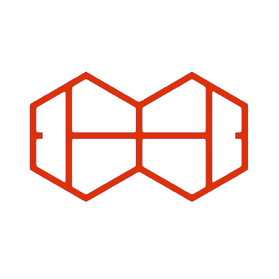
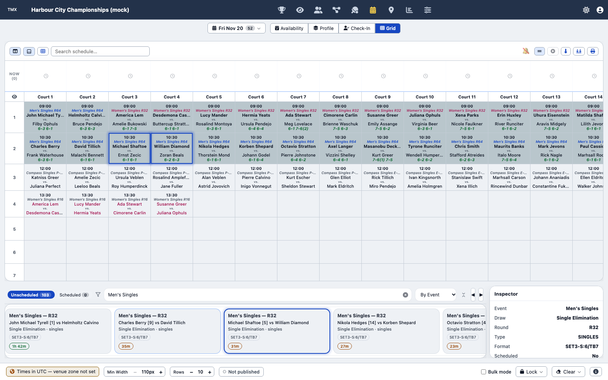
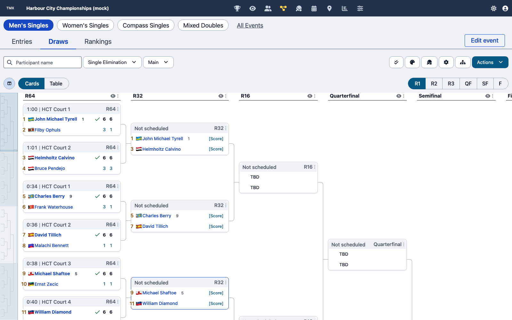
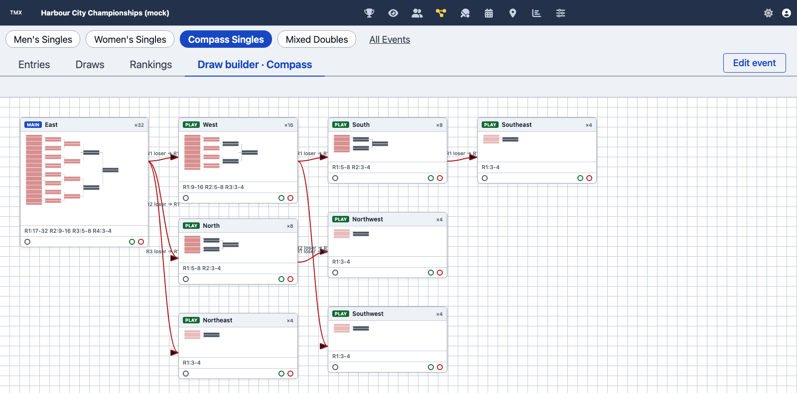

<p align="center">
  <a href="https://courthive.com/" target="_blank"></a>
</p>
<p align="center"><strong>TMX</strong> — the eXtensible Tournament Manager</p>
<p align="center"><a href="https://courthive.github.io/TMX">Online demo</a></p>

The [online demo](https://courthive.github.io/TMX) runs entirely in the browser against local storage — import
players from a spreadsheet, build a draw, schedule it. It tracks released versions rather than every commit.

## Overview

TMX is the operations client of the CourtHive platform: the screen a tournament desk actually runs the day on —
draws, entries, the order of play, the court grid, scores as they come in, and what the public is allowed to see.

It is a browser application (and a desktop build) powered by the **Competition Factory** — the same rules engine
that runs on the server and in the ingest pipeline. Everything it reads and writes is a **CODES** record,
CourtHive's canonical competition data standard, which the engine stores natively rather than exporting to. One
record flows unchanged from entry through scheduling to the public viewer, which is why a draw made here is the same
object a spectator sees.

That shared-engine design is the reason TMX can run local-first and still agree with everyone else on the
tournament: the client executes the same mutations the server does, so the desk keeps working when the network does
not. **[How CourtHive works](https://courthive.com/#/how-it-works)** walks through the whole picture — the one
engine, the three deployment lanes, and where TMX sits among the other surfaces.

<p align="center">
  
</p>
<p align="center"><em>Scheduling across sixteen courts. Completed matchUps carry their scores; the catalog along the
bottom shows what is still to be placed, with each card's rest chip reading rested (green) or still resting
(amber), and the selected card outlining the two matchUps it was waiting on.</em></p>

<table>
  <tr>
    <td width="50%"></td>
    <td width="50%"></td>
  </tr>
  <tr>
    <td align="center"><em>A draw, scored as it is played</em></td>
    <td align="center"><em>A draw's topology — a compass draw's eight structures and their links</em></td>
  </tr>
</table>

## What it does

**Draws and draw types** — single and double elimination, feed-in and feed-in championship, first-match and
first-round loser consolation, compass, Olympic, Curtis, page playoff, round robin (with or without playoffs),
Swiss, lucky draws, ad hoc and DrawMatic rounds, plus qualifying feeding a main draw. Any of them can be opened as a
**topology** — the structures and the links between them — and composed or adjusted in the draw builder, then saved
as a reusable template. Entry management covers singles, doubles and teams.

**Scheduling** — the largest surface, and the one that has grown the most:

- a court grid with drag-and-drop placement, schedule locks, and court-time-order conflict detection
- a **matchUp catalog**, docked beside or along the bottom of the grid, ordered by readiness, with a rest chip on
  each card so the next call can be chosen while scanning
- a **Now strip** — one cell per court showing what is live, suspended or called, with call-to-court and start-all
  bulk actions
- **readiness**: for any scheduled matchUp, whether it can actually start at the time written — an upstream match
  that will not finish in time, a participant due on court elsewhere, a recovery window that is not met. The
  scheduled time is coloured by what it finds
- **rest and recovery** tracking per player, including the side of a matchUp still being played for upstream
- **plan mode** — draft a day as a scenario without touching the official schedule
- venue and court availability, reserved cells, and printable court cards
- check-in, with a configurable prompt before a match is called to court

**Scoring and live scoring integration** — several input paths for different desk habits, including hotkey entry
from the matchUps table. **Delegated scoring** nominates a scorekeeper and takes a live relay from the court: live
scores show in the court grid, the draw and the matchUps table as they happen.

**Publishing and embargoes** — publish state per event, per draw, per stage and per structure, plus the order of
play, the participant list and the tournament information. Each can carry an **embargo**: published now, visible from
a set time, so a draw or a day's order of play can be prepared, checked and released on the organiser's schedule
rather than the moment it is ready. Rounds can be hidden individually.

**PDFs and printing** — draws, the order of play, player lists, sign-in sheets, fact sheets, match cards and court
cards (per court, per round, or all at once).

**Reports** — tournament reports exportable as PDF, CSV or JSON, and a structure audit that runs the engine's integrity
check on every draw and lists what it flags.

**Participants** — import from delimited files or Google Sheets with column auto-mapping, rating parsing and draft
merging before anything is committed.

**Officials** — an assignment board with eligibility rules and conflict-of-interest detection.

**Collaboration** — mutations travel over a WebSocket queue, so several people can run one tournament at once and
each sees the others' work as it lands. With chat and notifications alongside.

**Localisation** — English is bundled for instant first paint; other locales, including right-to-left ones, are
delivered at runtime and cached by content hash.

## Getting started

```bash
# Install dependencies (pnpm only — npm is blocked by `packageManager`)
pnpm install

# Development server
pnpm start

# Build for production
pnpm build

# Checks (what CI runs)
pnpm lint && pnpm format:check && pnpm attr-audit --ci && pnpm i18n-audit --ci
pnpm check-types
pnpm test --run

# Playwright journeys — 200+ specs, not run by CI
pnpm test:e2e
```

## Technology

|                    |                                                                                  |
| ------------------ | -------------------------------------------------------------------------------- |
| **Data standard**  | CODES — CourtHive's canonical competition record, written natively by the engine |
| **Business logic** | [tods-competition-factory](https://github.com/CourtHive/competition-factory)     |
| **UI components**  | [courthive-components](https://github.com/CourtHive/courthive-components)        |
| **Framework**      | Vanilla TypeScript — no React/Vue/Angular                                        |
| **Build**          | Vite · Electron for the desktop build                                            |
| **Storage**        | IndexedDB (Dexie) for tournament records, localStorage for preferences           |
| **Transport**      | Socket.IO to the competition factory server                                      |
| **Tables / PDF**   | Tabulator · pdfMake                                                              |
| **Testing**        | Vitest · Playwright                                                              |

## Related projects

- **[How CourtHive works](https://courthive.com/#/how-it-works)** — the platform in one page: the
  shared engine, the CODES record, and how the surfaces fit together
- **[Competition Factory](https://github.com/CourtHive/competition-factory)** — the rules engine
  TMX and the server both run
- **[courthive-components](https://github.com/CourtHive/courthive-components)** — shared UI components

## License

MIT — see [LICENSE.txt](LICENSE.txt).
